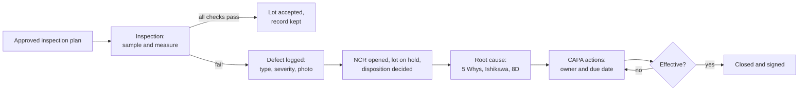

# Crucible

**Quality control and defect tracking on the production line.**

Crucible is a configurable, industry-agnostic web application that lets manufacturers
record production-line inspections, log defects with evidence, manage non-conformance
reports (NCR) and follow corrective and preventive actions (CAPA) through to verified
effectiveness — all traceable by lot, in **Arabic (RTL) and French**.

> ENSIA — third-year software development project · Group 2, Team 4 · 2026–2027

---

## Contents

- [What Crucible does](#what-crucible-does)
- [Tech stack](#tech-stack)
- [Repository layout](#repository-layout)
- [Getting started](#getting-started)
- [How we work](#how-we-work)
- [Documentation](#documentation)
- [Team](#team)
- [License](#license)

## What Crucible does



Version 1 (Week 14) commits to these **Must** features (full list in the [SRS](docs/srs/SRS.md)):

| ID  | Feature | ID  | Feature |
|-----|---------|-----|---------|
| F1  | Authentication and roles | F7  | CAPA with root-cause tools |
| F2  | Master data | F9  | Quality dashboard |
| F3  | Inspection plan builder | F11 | Reports and exports (PDF/Excel/CSV) |
| F4  | Inspection execution (ISO 2859-1 AQL) | F12 | Lot traceability |
| F5  | Defect logging | F13 | Audit trail and record integrity |
| F6  | NCR and disposition | F14 | Arabic / French, right-to-left |
|     |                     | F18 | Administration and backup |

**Should:** F8 notifications · F10 SPC (control charts, Cp/Cpk) · F15 offline shop-floor mode.
**Could:** F16 supplier quality · F17 gauge calibration register.

**Design principle:** the software knows nothing about any industry. Products, characteristics,
tolerances, defect catalogues, severities, sampling rules and terminology are *configuration
data*, never code.

## Tech stack

| Layer | Choice |
|-------|--------|
| Web client | React + TypeScript (Vite), RTL through CSS logical properties, optional PWA |
| Backend | Python 3.12, Django + Django REST Framework, OpenAPI documentation |
| Database | PostgreSQL 16 |
| Calculations | NumPy / SciPy (sampling, SPC, capability) — backend only |
| Charts | ECharts (display only) |
| PDF reports | WeasyPrint with an embedded Arabic font |
| Deployment | Docker Compose + Nginx (TLS), one deployment per customer |
| CI | GitHub Actions: lint, unit + API tests, build, dependency scan |
| E2E tests | Playwright (UC1, UC2 in Arabic and French, desktop and tablet) |

## Repository layout

```text
G2-Team4/
├── backend/          Django modular monolith (one Django app per domain module)
├── frontend/         React + TypeScript client (management UI + shop-floor UI)
├── e2e/              Playwright end-to-end tests spanning front and back
├── infra/            Docker Compose, Nginx, backup/restore scripts
├── docs/
│   ├── srs/          Software Requirements Specification (source of truth)
│   ├── process/      Scrum: working agreement, backlog, Trello guide, templates
│   ├── research/     Practitioner interviews, competitor notes
│   ├── architecture/ Architecture overview and decision records (ADRs)  — Sprint 1
│   └── compliance/   Law 18-07 / ANPDP documents                        — Sprint 1
├── .github/          CI workflows, PR template, CODEOWNERS
├── CONTRIBUTING.md   Branches, commits, pull requests, reviews
└── README.md
```

Each top-level folder has a **lead** (see [CODEOWNERS](.github/CODEOWNERS)) who reviews
changes to it, but everyone writes code everywhere. The mapping follows §14 of the
specification:

| Folder | Lead role |
|--------|-----------|
| `backend/` | Backend lead |
| `frontend/` | Frontend and PWA lead |
| `e2e/`, test plans | QA, security and compliance |
| `infra/`, `.github/workflows/` | Data, analytics and DevOps |
| `docs/` | UX, documentation and business plan · Product owner for `docs/srs/` |

## Getting started

### Running the prototype (F4 inspection)

The app is **two programs running at the same time**, each in its own terminal:

| | Backend (Django) | Frontend (React / Vite) |
|---|---|---|
| What it does | Stores lots, inspections and defects; computes sampling and the decision | The screens the user clicks |
| Started with | `python manage.py runserver` | `npm run dev` |
| Address | http://127.0.0.1:8000 (API only, no pages) | **http://localhost:5173/inspection** ← open this |

The frontend forwards every `/api/...` call to the backend, so if the backend is not
running the screen shows "Serveur injoignable".

**When to do what**

| When | Where | Command |
|------|-------|---------|
| Once, after cloning | `backend/` | `python -m venv .venv` then `.venv\Scripts\activate` then `pip install -r requirements.txt` |
| Once, after cloning | `frontend/` | `npm install` |
| After cloning, and after every pull that adds a file in `backend/inspections/migrations/` | `backend/` | `python manage.py migrate` (creates/updates `db.sqlite3` and the demo lots) |
| Every time you work or demo | `backend/` (venv activated) | `python manage.py runserver` |
| Every time you work or demo (second terminal) | `frontend/` | `npm run dev` |
| Before a demo, or when every lot is already inspected | `backend/` | `python manage.py reset_demo` (dev only, erases inspections) |
| Before pushing | `backend/` · `frontend/` | `python manage.py test` · `npm run build` and `npm run lint` |
| After a pull that changes `requirements.txt` / `package.json` | `backend/` · `frontend/` | `pip install -r requirements.txt` · `npm install` |

On macOS/Linux activate the venv with `source .venv/bin/activate`.

**Showing it to others:** run both on your laptop and open `localhost:5173` (or project it).
GitHub Pages cannot host this version: it only serves static files, and the app needs the
Django server running. A public demo would need a small host for Django (later, with the
Algerian-hosting decision R2).

### Prerequisites

Prerequisites for every developer:

- Git ≥ 2.40, with `core.autocrlf` left at its default — the repo's `.gitattributes` handles line endings
- Python 3.12 (the version used in CI and Docker)
- Node.js 22 LTS or newer, npm
- Docker Desktop (for PostgreSQL and the full stack, later); **not needed for the prototype**, which uses SQLite
- An editor that honours [`.editorconfig`](.editorconfig)

```bash
git clone https://github.com/RAHAI-HAKIM/G2-Team4.git
```

## How we work

We follow **Scrum** with two-week sprints mapped onto the 14-week milestone plan.

- Backlog and sprint board: **Trello** (single source of truth for work items)
- Code, reviews and CI: **GitHub** (`main` is always demo-able; work happens on short-lived branches)
- Rules for branches, commits and pull requests: [CONTRIBUTING.md](CONTRIBUTING.md)
- Roles, ceremonies, Definition of Ready / Done: [docs/process/scrum.md](docs/process/scrum.md)

## Documentation

| Document | Purpose |
|----------|---------|
| [Software Requirements Specification](docs/srs/SRS.md) | What the system must do — every feature, rule and quality target |
| [Scrum working agreement](docs/process/scrum.md) | Roles, sprint calendar, ceremonies, DoR / DoD |
| [Product backlog](docs/process/product-backlog.md) | User stories and enablers, by sprint |
| [Trello setup](docs/process/trello-setup.md) | How the board is organised |
| [Interview guide](docs/research/interview-guide.md) | Practitioner interviews (objective O5, risk R3) |

## Team

| Member | Role (spec §14) |
|--------|-----------------|
| RAHAI Mohamed Abdelhakim | Project lead and product owner |
| BENCHIBANE Mouminat | *to be assigned* |
| ALLALI Bouchra | *to be assigned* |
| HAMADACHE Thoraya | *to be assigned* |
| MERAD Ouijdane | *to be assigned* |
| RAHMANI Rania | *to be assigned* |

Roles to fill: Backend lead · Frontend and PWA lead · UX, documentation and business plan ·
QA, security and compliance · Data, analytics and DevOps.

## License

Copyright © 2026 the Crucible team (ENSIA G2-Team4). All rights reserved.
No license is granted until the team and the supervisor decide otherwise.
