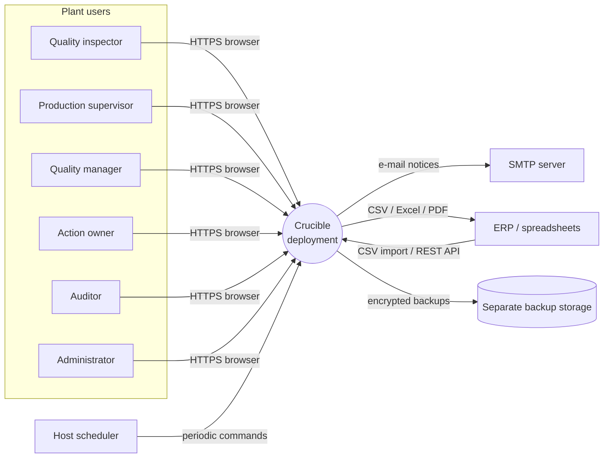
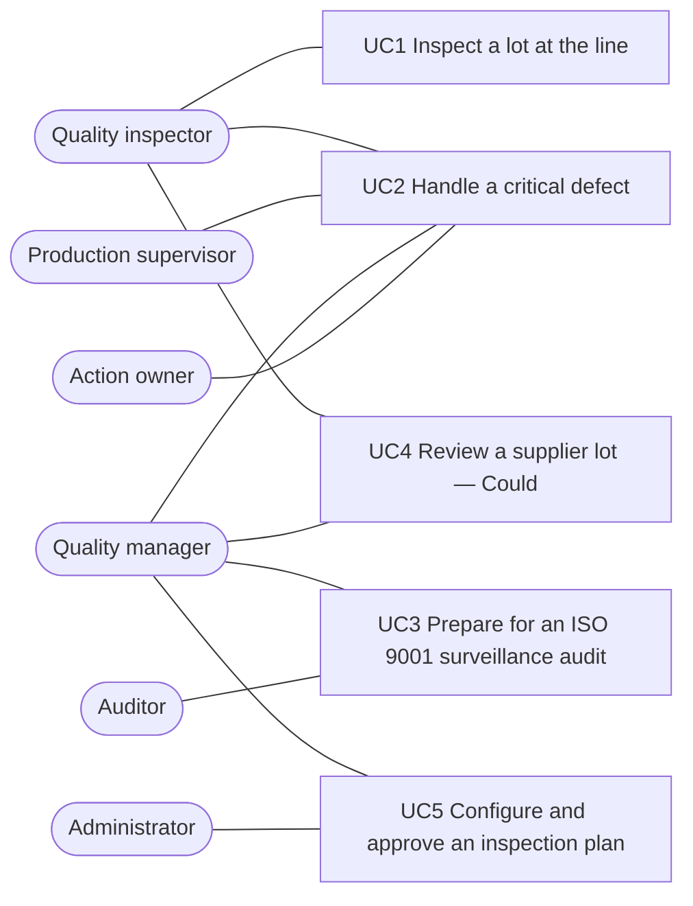
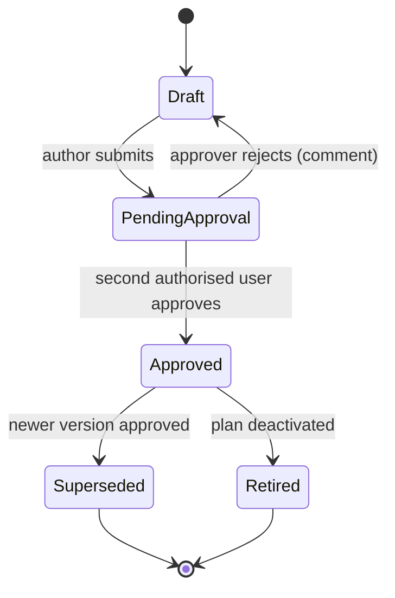
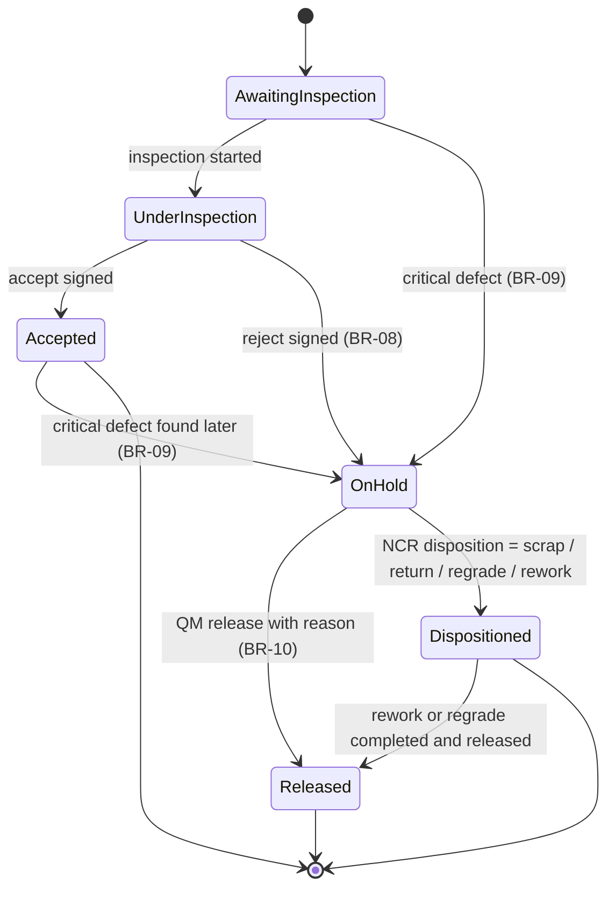
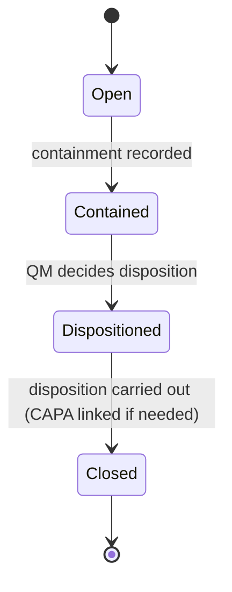
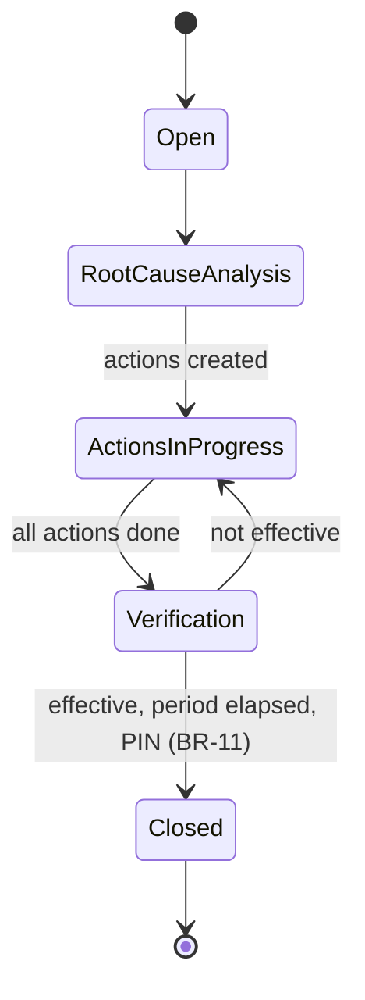
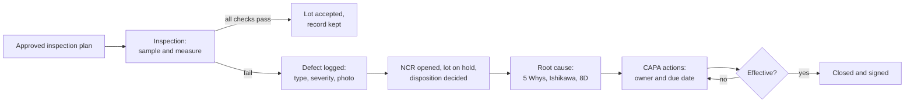
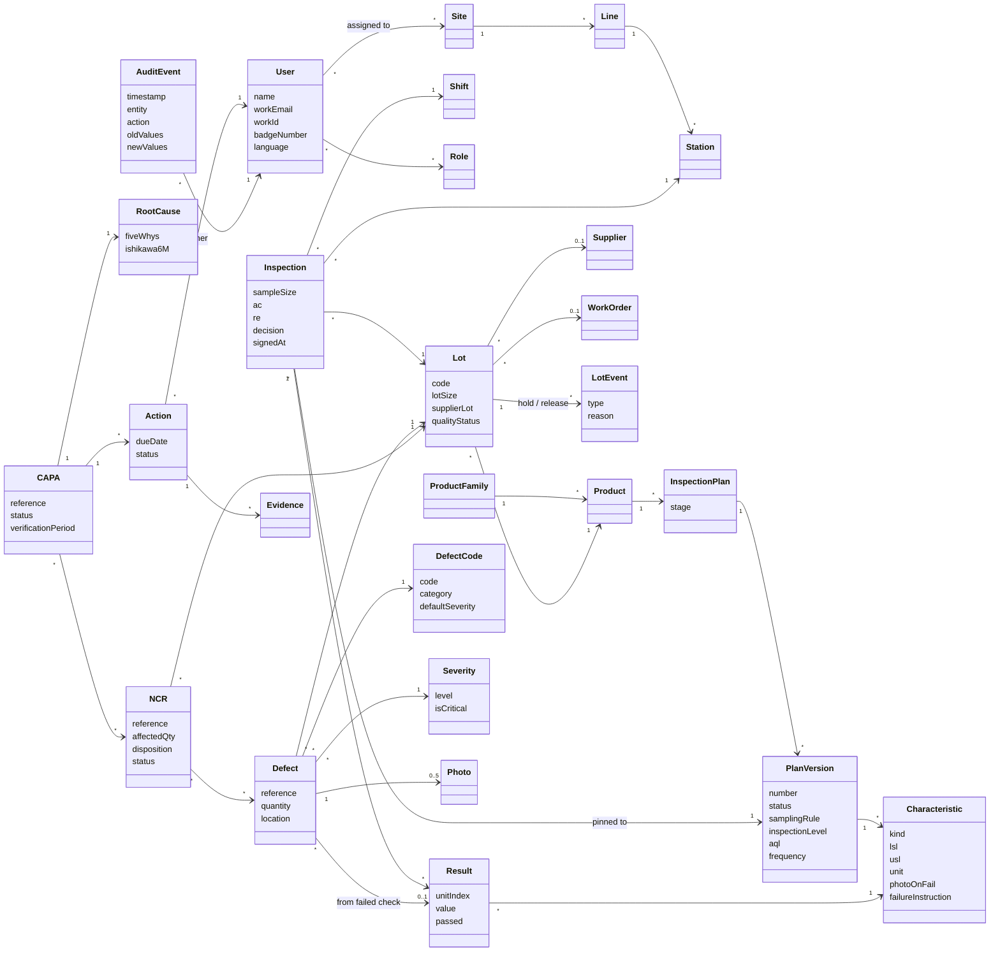

# Software Requirements Specification — Crucible

**Quality control and defect tracking on the production line**

| | |
|---|---|
| **Document** | Software Requirements Specification (SRS) |
| **Product** | Crucible, version 1 |
| **Version** | 0.1 — draft for team review |
| **Date** | 16 November 2026 |
| **Source** | *Crucible: Product Specification and Business Plan*, v1.1 (11 November 2026) |
| **Owner** | Product owner — RAHAI Mohamed Abdelhakim |
| **Team** | ENSIA, third-year software development project, Group 2 Team 4: RAHAI Mohamed Abdelhakim, BENCHIBANE Mouminat, ALLALI Bouchra, HAMADACHE Thoraya, MERAD Ouijdane, RAHMANI Rania |
| **Structure** | Based on IEEE Std 830-1998 / ISO/IEC/IEEE 29148:2018 |

---

## Table of contents

1. [Introduction](#1-introduction)
2. [Overall description](#2-overall-description)
3. [Use cases](#3-use-cases)
4. [System features (functional requirements)](#4-system-features-functional-requirements)
5. [Business rules, calculations and life cycles](#5-business-rules-calculations-and-life-cycles)
6. [External interface requirements](#6-external-interface-requirements)
7. [Non-functional requirements](#7-non-functional-requirements)
8. [Data requirements](#8-data-requirements)
9. [Verification](#9-verification)
10. [Traceability](#10-traceability)
- [Appendix A — Glossary](#appendix-a--glossary)
- [Appendix B — Open issues (TBD)](#appendix-b--open-issues-tbd)
- [Appendix C — Change history](#appendix-c--change-history)

---

## 1. Introduction

### 1.1 Purpose

This document specifies the software requirements of **Crucible version 1**, the release
demonstrated in Week 14 of the ENSIA third-year project. It turns the product specification
and business plan (v1.1) into precise, numbered, testable requirements.

It is the reference for:

- the **development team**, to know what to build and when a feature is done;
- the **QA owner**, to derive test cases (§9);
- the **supervisor**, to evaluate scope and completeness;
- **pilot plants and practitioners**, to validate the configurable model (objective O5).

Market analysis, pricing, financial projections and marketing (spec §3–4, §8–12) are
**not** repeated here; they remain in the product specification.

### 1.2 Product scope

Crucible is a configurable, industry-agnostic web application for manufacturers. It lets a plant:

- define **inspection plans** for its products and approve them;
- **record inspections** on the line against those plans, with ISO 2859-1 sampling;
- **log defects** with severity and photographic evidence;
- manage **non-conformance reports (NCR)**, including holding and releasing lots;
- run **corrective and preventive actions (CAPA)** through root-cause analysis to a verified-effective closure;
- **analyse** quality through a dashboard, Pareto charts and statistical process control;
- **produce evidence** for customers and auditors (PDF reports in Arabic or French, Excel/CSV exports, an audit trail, lot traceability).

The product supports quality-management practices associated with ISO 9001:2015. **It does
not certify compliance with the standard.**

**Benefit:** one linked chain from inspection to verified corrective action, traceable by lot,
replacing paper records and scattered spreadsheets.

### 1.3 Project objectives (Week 14)

The requirements in this document serve the following project objectives (spec §2.5).
Section 10 traces each requirement back to them.

| ID | Objective | Acceptance measure |
|----|-----------|--------------------|
| O1 | Deliver a working web application covering every **Must** feature of §4 | Live demonstration of UC1 and UC2 on a staging server |
| O2 | Make the defect-to-CAPA chain traceable by lot | From any lot code, one view shows its inspections, defects, NCR and CAPA |
| O3 | Prove that the inspection screen is usable on the shop floor | Usability test with ≥ 5 users: median time to log a defect ≤ 60 s and ≥ 80% task success |
| O4 | Produce trustworthy quality calculations | AQL sample sizes and SPC limits match the published reference tables and a NumPy/R cross-check in automated tests |
| O5 | Validate the need and the configurable model with practitioners | ≥ 5 interviews with quality practitioners and a hands-on trial of a reference product by Week 4 |
| O6 | Document the data-protection approach under Algerian law | Processing register, privacy notice and ANPDP enquiry |
| O7 | Demonstrate that the product is industry-agnostic | Two industry configurations (e.g. bottling line, metal-parts line) set up through the interface, without code changes, run live in Week 14 |

### 1.4 Intended audience and reading suggestions

| Reader | Read first |
|--------|-----------|
| Every team member | §2 (overview), §3 (use cases), §5.1 (business rules) |
| Backend developers | §4, §5, §8 |
| Frontend developers | §3, §4, §6.1, §7.5–7.6 |
| QA, security and compliance | §5.2, §7.3–7.4, §9, §10 |
| Supervisor / evaluator | §1, §2, §3, §10 |

### 1.5 Document conventions

**Requirement identifiers.** Each requirement has a stable ID that is never reused:

| Prefix | Meaning | Section |
|--------|---------|---------|
| `F1`…`F18` | Feature (from spec §6.2) | §4 |
| `AUTH`, `MD`, `PLAN`, `INSP`, `DEF`, `NCR`, `CAPA`, `NOT`, `DASH`, `SPC`, `RPT`, `TRC`, `AUD`, `I18N`, `OFF`, `SUP`, `GAU`, `ADM` | Functional requirement within a feature | §4 |
| `UC1`…`UC5` | Use case | §3 |
| `BR` | Business rule | §5.1 |
| `CAL` | Calculation rule | §5.2 |
| `UI`, `HW`, `SW`, `COM` | External interface requirement | §6 |
| `NF1`…`NF8` | Non-functional requirement (from spec §7.2) | §7 |
| `SEC`, `PRIV` | Security / data-protection requirement | §7.3, §7.4 |
| `DC`, `AS` | Design constraint / assumption or dependency | §2.6, §2.8 |
| `VER` | Verification requirement | §9 |
| `TBD` | Open issue to resolve | Appendix B |

**Keywords.** *shall* = mandatory for the feature's priority; *should* = desirable;
*may* = optional.

**Priority (MoSCoW, spec §6.2).**

| Priority | Meaning for Week 14 |
|----------|---------------------|
| **Must** | Committed. The demonstration fails without it. |
| **Should** | Built if the schedule holds. |
| **Could** | Started only once every Should item is done. |

A requirement inherits its feature's priority unless marked otherwise.

**Status tags carried from the specification.** `[A]` = assumption to be confirmed by a named
test; `[E]` = team estimate. Requirements derived by the team (not written explicitly in the
specification) are marked **[derived]** and must be confirmed at review.

### 1.6 References

| Ref | Document |
|-----|----------|
| [SPEC] | Crucible: Product Specification and Business Plan, v1.1, 11 November 2026 |
| [ISO9001] | ISO 9001:2015 Quality management systems — Requirements (and ISO 9001:2026, published 16 September 2026) |
| [ISO2859] | ISO 2859-1 Sampling procedures for inspection by attributes — Part 1: Sampling schemes indexed by AQL |
| [ISO7870] | ISO 7870 series — Control charts |
| [ISO22514] | ISO 22514 series — Statistical methods in process management — Capability and performance |
| [L18-07] | Algerian Law 18-07 of 10 June 2018 on the protection of natural persons in the processing of personal data, amended by Law 25-11 of 24 July 2025 |
| [ANPDP-03] | ANPDP Decision 03 of 6 May 2026 (prior authorisation for biometric attendance control) |
| [ARPT] | ARPT 2018 specifications for cloud providers (hosting on Algerian territory) |
| [ASVS] | OWASP Application Security Verification Standard, level 2 |
| [WCAG] | Web Content Accessibility Guidelines 2.1, level AA |

---

## 2. Overall description

### 2.1 Product perspective

Crucible is a **new, self-contained product**. It does not replace an existing system; it
replaces paper checklists and spreadsheets. A plant that already runs an ERP keeps it and
exchanges data with Crucible through CSV files and a REST API.

Each customer has its **own deployment** (one database, one file store, one set of backups),
hosted in an Algerian data centre or installed on the plant network.

**Design principle — configurable and industry-agnostic.** The software knows nothing about
the industry it serves. Products and families, characteristics and tolerances, check types,
defect codes and categories, severities, sampling rules, frequencies, failure rules and
terminology are **configuration data held in the database**. No sector-specific field,
workflow or label is hard-coded; a new industry is onboarded by configuration, not by
development (BR-01). Optional industry packs are pre-built configurations, never forks.

### 2.2 Product functions

| ID | Feature | Priority | Summary |
|----|---------|----------|---------|
| F1 | Authentication and roles | Must | Login, lockout, six roles, site scoping, shared-tablet switch with badge + PIN |
| F2 | Master data | Must | Sites, lines, products, lots, suppliers, shifts, defect catalogue; CSV import; deactivate, never delete |
| F3 | Inspection plan builder | Must | Per product and stage; attribute/variable characteristics; sampling rule; versioning; second-person approval |
| F4 | Inspection execution | Must | ISO 2859-1 sample size, per-unit results, out-of-limit flags, accept/reject proposal, PIN signature |
| F5 | Defect logging | Must | From a failed check or standalone; code, severity, location, up to five photos; automatic reference |
| F6 | NCR and disposition | Must | Containment, affected quantity, disposition; automatic hold on critical defect; QM release with reason |
| F7 | CAPA with root-cause tools | Must | From NCRs; 5 Whys, Ishikawa (6M); actions with owner and due date; effectiveness check before closure; 8D PDF |
| F8 | Notifications and escalation | Should | E-mail and in-app notices; escalation after a configurable delay |
| F9 | Quality dashboard | Must | Defect rate, FPY, open NCRs, CAPA on-time rate, inspections today, Pareto, trends, filters |
| F10 | Statistical analysis | Should | X̄-R, p, np, c charts; Western Electric rules 1–4; histogram; Cp, Cpk |
| F11 | Reports and exports | Must | Inspection report, NCR/8D report, monthly summary as PDF (Arabic or French); Excel/CSV export |
| F12 | Lot traceability | Must | Search by lot, serial or supplier lot; one view of every linked record |
| F13 | Audit trail and record integrity | Must | Append-only log; closed records locked; exportable |
| F14 | Languages and layout | Must | Arabic (RTL), French; English for development; per-user switch |
| F15 | Offline mode for inspections | Should | Cache plans and master data; queue entries offline; sync with visible counter |
| F16 | Supplier quality | Could | Supplier score, supplier corrective-action request, trends |
| F17 | Gauge and calibration register | Could | Calibration due dates; warning in inspection |
| F18 | Administration and backup | Must | User and settings screens, nightly backup, restore procedure, data retention |

### 2.3 User classes and characteristics

| Role | Typical person | Needs | Main interface |
|------|----------------|-------|----------------|
| **Quality inspector** | Operator or technician who checks samples at a station or at final inspection | Enter measurements and pass/fail results in seconds on a tablet, with no training manual; see the right plan automatically | Shop floor (tablet) |
| **Production supervisor** | Line or shift leader | Be told immediately when a lot is held; see the day's defects by line and shift; receive actions assigned to the line | Management + shop floor |
| **Quality manager** | Head of quality or quality engineer | Define plans, decide dispositions, run root-cause analysis, assign and close CAPA, report to management, prepare audits | Management (desktop) |
| **Action owner** | Maintenance, purchasing or production staff assigned a corrective action | See only their own actions, update status, attach evidence | Management (desktop or tablet) |
| **Auditor** (read-only) | Internal, customer or certification-body auditor with limited access | Browse records and the audit trail, export evidence, change nothing | Management (desktop) |
| **Administrator** | IT or quality-system owner at the plant | Manage users, sites, backups and settings | Management (desktop) |

**Personas (working assumptions, to be validated in interviews — O5):**

- *The inspector* must log a defect in under a minute, standing at the line, possibly wearing gloves, on a shared tablet.
- *The quality manager* currently spends about two days a month assembling a defect report from paper and spreadsheets.

### 2.4 Permissions

The matrix is enforced on **every API operation** (AUTH-05). In addition, a user assigned to
one site never sees another site's records unless an administrator grants access (AUTH-06).

| Capability | Admin | Quality mgr | Inspector | Supervisor | Action owner | Auditor |
|------------|:-----:|:-----------:|:---------:|:----------:|:------------:|:-------:|
| Manage users, roles and sites | ✔ | – | – | – | – | – |
| Configure master data and defect catalogue | ✔ | ✔ | – | – | – | – |
| Create and edit inspection plans | ✔ | ✔ | – | – | – | – |
| Approve inspection plans (not the author) | ✔ | ✔ | – | – | – | – |
| Run inspections and log defects | – | ✔ | ✔ | ✔ | – | – |
| Open an NCR | – | ✔ | ✔ | ✔ | – | – |
| Decide disposition and release a held lot | – | ✔ | – | – | – | – |
| Create and assign CAPA | – | ✔ | – | ✔ | – | – |
| Update an assigned action | – | ✔ | – | ✔ | Own | – |
| Close CAPA after effectiveness check | – | ✔ | – | – | – | – |
| View dashboards and analysis | ✔ | ✔ | ✔ | ✔ | Own | ✔ |
| Export reports and evidence | ✔ | ✔ | – | ✔ | – | ✔ |
| View the audit log | ✔ | ✔ | – | – | – | ✔ |

*Own* = limited to records assigned to that user.

### 2.5 Operating environment

| Element | Environment |
|---------|-------------|
| Client browsers | Current and previous versions of Chrome, Edge and Firefox (NF8) |
| Client devices | Plant PCs on supported Windows versions; Android tablets of 8 inches or more; a low-resource reference PC for performance testing |
| Server | One Linux host per deployment running Docker Compose: Nginx (HTTPS reverse proxy), Django application, PostgreSQL 16, protected file storage |
| Hosting | An Algerian data centre (hosted offer) or a server on the plant network (on-premise offer) |
| Network | Plant LAN; internet connectivity may be unreliable on the shop floor (F15) |

### 2.6 Design and implementation constraints

| ID | Constraint | Source |
|----|-----------|--------|
| DC-01 | Web client in **React with TypeScript**; backend in **Python 3.12, Django and Django REST Framework**; database **PostgreSQL 16**. | SPEC §7.1 |
| DC-02 | Architecture is a **modular monolith** with modules for inspection, defects, NCR and CAPA, analysis and administration. No distributed services, no message broker; periodic tasks are Django management commands run by the host scheduler. | SPEC §7.1 |
| DC-03 | **One deployment per customer**, with its own database and file storage, deployed with Docker Compose behind Nginx with TLS. | SPEC §7.1, §7.5 |
| DC-04 | Hosted deployments use an **Algerian data centre**; on-premise installation is the alternative. | ARPT, SPEC §3.5 |
| DC-05 | Processing of personal data complies with **Law 18-07 as amended by Law 25-11**. | L18-07 |
| DC-06 | **No biometric** login or attendance feature in any version. | ANPDP-03 |
| DC-07 | **All quality calculations run in the backend** (one authoritative calculation path, testable against reference values). Charts in the client (ECharts) only display results. | SPEC §7.1 |
| DC-08 | PDF reports are produced from HTML with **WeasyPrint** and an **embedded Arabic font**. | SPEC §7.1 |
| DC-09 | The application calls **no foreign analytics, font, map or e-mail service**. | SPEC §7.3 |
| DC-10 | The quality pipeline uses **GitHub Actions**: linting, unit and API tests, build, dependency vulnerability scan. | SPEC §7.1 |
| DC-11 | Delivery within **14 weeks** by a team of six students, including examinations. Only Must features are committed. | SPEC §13 R6 |
| DC-12 | Sampling tables and control-chart constants are **stored as data**, not as code constants, and are tested against the published tables. | SPEC §3.5 |
| DC-13 | Clause references follow ISO 9001:2015 numbering and will be re-mapped to ISO 9001:2026. | SPEC §3.5 |

### 2.7 User documentation

| Document | Language | Delivered |
|----------|----------|-----------|
| Inspector guide (short, illustrated) | Arabic, French | Week 13 |
| Administrator and installation guide (on-premise) | Arabic, French | Week 13 |
| Support documentation | Arabic, French | Week 13 |
| REST API reference (OpenAPI, generated) | English | Continuously |

### 2.8 Assumptions and dependencies

| ID | Assumption or dependency | How it is checked |
|----|--------------------------|-------------------|
| AS-01 | Many Algerian plants record inspections on paper and spreadsheets. `[A]` | Practitioner interviews (O5) |
| AS-02 | Plants can provide tablets running a supported browser, or accept the demonstration kit. | Interviews, pilot |
| AS-03 | A plant LAN exists; internet access may be intermittent. | Interviews, pilot |
| AS-04 | An SMTP server is available (customer's or the hosting provider's in Algeria). | Hosting quotes (R2) |
| AS-05 | The team obtains the ISO 2859-1 tables and control-chart constants from an authorised source (library or purchase) to build reference tests. | RS-009, R7 |
| AS-06 | A pilot plant is available, or a realistic simulated dataset is used instead. | R3 gate, Week 4 |
| AS-07 | The NF1 performance figures are achievable on the reference hardware. `[A]` | Load test, Week 12 |
| AS-08 | Counsel confirms that the customer is controller and the project is processor when it hosts. | R1 gate |
| AS-09 | Subscription-tier limits (users, sites per plan) are commercial terms; enforcing them in software is **not** required for version 1. **[derived]** | PO decision |

### 2.9 Out of scope for version 1

| Deferred feature | Condition to reconsider |
|------------------|-------------------------|
| Computer-vision classification of defect photos | Pilot plants have produced hundreds of labelled images per defect type |
| Direct links to instruments and PLCs | Two pilot plants use the same instrument family |
| ERP connectors (SAP, Odoo, Sage…) | A connector is needed by two or more pilot customers; CSV and REST API come first |
| Native mobile application | Camera, scanner or offline needs exceed what browsers provide |
| Supplier self-service portal | F16 is in use and a stronger security review is done |
| Document control, internal audit planning, management review | Out of product focus (full QMS suites) |
| FMEA and control plans | The IATF 16949 segment asks for them |
| Customer-complaint and returns module | Core workflow validated |
| Biometric login and attendance | **Excluded by design** (DC-06) |
| LDAP / directory login | Later option |

**Optional extensions** — started only if every Should item is done: industry packs,
recurring-defect detection, adaptive sampling (ISO 2859-1 switching rules), statistical
verification of CAPA effectiveness.

---

## 3. Use cases

### 3.1 Use-case overview

### 3.2 UC1 — Inspect a lot at the line

| | |
|---|---|
| **Primary actor** | Quality inspector |
| **Priority** | Must |
| **Goal** | Record a sampling inspection of a lot against its approved plan and reach an accept/reject decision |
| **Preconditions** | The inspector is logged in on the shop-floor interface; the lot exists (F2); an approved plan exists for the lot's product and stage (F3) |
| **Trigger** | A lot reaches an inspection point (incoming, in-process or final) |
| **Postconditions (success)** | A time-stamped inspection record, signed with the inspector's PIN, is linked to the lot and to the plan version used; the lot is accepted or on hold |
| **Requirements** | INSP-01…INSP-10, DEF-01…DEF-05, BR-03, BR-04, BR-05, BR-08, CAL-01 |

**Main flow**

1. The inspector selects the line, the work order and the lot.
2. The system proposes the approved plan for the lot's product and stage and computes the sample size from the lot size, inspection level and AQL.
3. For each unit of the sample, the inspector enters measurements and pass/fail marks.
4. The system flags at once any value outside its specification limits.
5. When all units are checked, the system compares the number of defective units with the acceptance number and **proposes** accept or reject.
6. The inspector confirms the decision and signs with their PIN.
7. The system stores the inspection record, linked to the lot and the plan version.

**Alternative and exception flows**

- **3a. A check fails** → the system offers *Log defect* (UC2 step 1 / F5) and, when the characteristic requires it, a photo.
- **5a. The proposal is reject** → on confirmation the lot goes **on hold** (BR-08) and the supervisor and quality manager are notified (F8).
- **2a. No approved plan exists** for the product and stage → the system says so and does not allow an unplanned inspection; the inspector may still log a standalone defect (DEF-01).
- **6a. Wrong PIN** → the decision is not signed; repeated failures count toward lockout (AUTH-03).
- **\*a. Connection lost** (if F15 is built) → entries are queued on the device and synchronised later (OFF-02).

### 3.3 UC2 — Handle a critical defect

| | |
|---|---|
| **Primary actors** | Quality inspector, quality manager |
| **Secondary actors** | Production supervisor, action owner |
| **Priority** | Must |
| **Goal** | Contain a critical defect, decide what happens to the lot, remove the cause and prove the fix worked |
| **Preconditions** | A check has failed, or a defect is observed outside an inspection |
| **Postconditions (success)** | A complete 8D-style record — defect, NCR, disposition, root cause, actions, effectiveness evidence — visible from the lot |
| **Requirements** | DEF-*, NCR-*, CAPA-*, NOT-01, NOT-02, BR-09…BR-11, BR-13, CAL-12 |

**Main flow**

1. The inspector chooses *Log defect* and enters type, severity and a photo.
2. Because the severity is critical, the system puts the lot **on hold** and notifies the supervisor and the quality manager (BR-09).
3. The quality manager opens the NCR and records containment actions and the affected quantity.
4. The quality manager chooses a disposition: rework, scrap, use-as-is concession, return to supplier or regrade.
5. The quality manager opens a CAPA from the NCR and starts root-cause analysis with 5 Whys or an Ishikawa diagram.
6. The quality manager creates CAPA actions with owners and due dates.
7. Each action owner updates their action and attaches evidence.
8. After the verification period, the system shows defect rates before and after the fix; the quality manager judges effectiveness.
9. If effective, the quality manager closes the CAPA after PIN re-authentication.

**Alternative flows**

- **5a. Recurring defect** — a CAPA may be opened from several NCRs (e.g. the same defect three times in a week).
- **8a. Not effective** — the CAPA returns to actions in progress (step 6).
- **4a. Release** — the lot leaves hold only by an explicit release by the quality manager with a reason (BR-10).
- **7a. Overdue action** — the owner and then the escalation target are notified (NOT-02, Should).

### 3.4 UC3 — Prepare for an ISO 9001 surveillance audit

| | |
|---|---|
| **Primary actors** | Quality manager, auditor |
| **Priority** | Must |
| **Goal** | Produce audit evidence for a period and product family within two minutes |
| **Preconditions** | Records exist for the period; the auditor has a read-only account limited to the relevant sites |
| **Postconditions** | A report of nonconformities and corrective actions with closure status and effectiveness evidence, plus monitoring results |
| **Requirements** | RPT-02, RPT-03, RPT-06, RPT-07, AUD-03, AUD-05, TRC-*, DASH-* |

**Main flow**

1. The quality manager selects a period and a product family.
2. The system produces the nonconformity and corrective-action report with closure status and effectiveness evidence, plus the monitoring results (dashboard indicators, control charts where available).
3. The auditor reviews records and the audit trail with read-only access, and exports evidence.

### 3.5 UC4 — Review a supplier lot (Could)

| | |
|---|---|
| **Primary actors** | Quality inspector (incoming), quality manager |
| **Priority** | Could (F16) |
| **Goal** | Measure supplier performance from incoming inspections |
| **Requirements** | SUP-01…SUP-03, INSP-*, NCR-01 |

**Main flow**

1. The incoming inspector records an incoming inspection (as UC1, stage *incoming*).
2. A rejection opens an NCR tied to the supplier.
3. The system issues a supplier corrective-action request as a PDF and updates the supplier score.

### 3.6 UC5 — Configure and approve an inspection plan

| | |
|---|---|
| **Primary actors** | Quality manager or administrator (author), a second authorised user (approver) |
| **Priority** | Must |
| **Goal** | Create an approved, versioned plan entirely through the interface, with no industry-specific code |
| **Postconditions** | An approved plan version, available to inspectors; every later inspection is pinned to the version it used |
| **Requirements** | PLAN-01…PLAN-08, BR-01…BR-03 |

**Main flow**

1. The author creates a plan for a product and a stage.
2. The author adds characteristics (pass/fail, or measured with limits and unit), the sampling rule, the frequency and the failure instruction.
3. The author submits the plan for approval.
4. A second authorised user reviews and approves it.

**Alternative flows**

- **4a. Rejected** — the approver gives a comment; the plan returns to draft.
- **5. Later edit** — editing an approved plan creates a new version in draft; the previous version stays in use until the new one is approved.

---

## 4. System features (functional requirements)

Each subsection gives the feature's description and priority, its stimulus/response
behaviour where useful, and its numbered functional requirements.

### 4.1 F1 — Authentication and roles (Must)

Secure login for all users, role and site enforcement, and a fast user switch for shared
shop-floor tablets. No biometrics.

| ID | Requirement |
|----|-------------|
| AUTH-01 | The system shall authenticate users by **work e-mail or work ID** and **password**. |
| AUTH-02 | The system shall store passwords hashed with **Argon2id** only. |
| AUTH-03 | The system shall lock an account after a configurable number of consecutive failed attempts, for a configurable duration (TBD-01). An administrator shall be able to unlock it. Failed attempts and locks shall be audit-logged. |
| AUTH-04 | The system shall support the six roles of §2.3. A user shall be able to hold one or more roles (TBD-03). |
| AUTH-05 | The system shall enforce the permission matrix of §2.4 **on every API call**, not only in the user interface. |
| AUTH-06 | The system shall restrict every user to the records of the sites assigned to them; an administrator may grant access to further sites. |
| AUTH-07 | On the shop-floor interface, the system shall provide a **fast user switch** with **badge number and PIN**. |
| AUTH-08 | The system shall require the user's **PIN** to sign an inspection decision (INSP-06) and to re-authenticate before closing a CAPA (CAPA-06). |
| AUTH-09 | The system shall end a session after a configurable period of inactivity (TBD-06). |
| AUTH-10 | The system shall not offer any biometric authentication (DC-06). |
| AUTH-11 | The system shall let a user log out; logging out shall invalidate the session on the server. |
| AUTH-12 | An administrator shall be able to reset a user's password and PIN; the user shall be required to change a reset password at next login. **[derived]** (TBD-14) |

### 4.2 F2 — Master data (Must)

All reference data a plant needs, configurable and never tied to an industry.

| ID | Requirement |
|----|-------------|
| MD-01 | Authorised users shall be able to create, edit and deactivate: **sites, lines, stations, products and product families, lots and work orders, suppliers, shifts**, and the **defect catalogue** (code, description, category, default severity). |
| MD-02 | Records shall be **deactivated, never deleted** (BR-06). Deactivated records shall not be offered in selection lists but shall remain visible on existing records and in history. |
| MD-03 | The system shall import master data from **CSV** and produce a **row-level error report** (row number, field, reason). Each row is imported completely or not at all. |
| MD-04 | All lists and terms (defect categories, severity levels, units, check types, terminology labels) shall be **configurable**; none shall be specific to one industry. |
| MD-05 | A lot shall record at least: lot code, product, lot size (quantity), origin (work order, or supplier and supplier lot number), and optionally serial numbers (TBD-16). |
| MD-06 | The severity scale shall be configurable; at least one severity level shall be flagged **critical**, which triggers BR-09. |
| MD-07 | Names and descriptions of configuration data shall be storable in **Arabic and French** (I18N-04). **[derived]** |

### 4.3 F3 — Inspection plan builder (Must)

| ID | Requirement |
|----|-------------|
| PLAN-01 | An authorised user shall be able to create an inspection plan for a **product** (or product family) and a **stage**: incoming, in-process or final. |
| PLAN-02 | A plan shall contain characteristics of two kinds: **attribute** (pass/fail) or **variable** (lower specification limit, upper specification limit, unit; at least one limit). Each characteristic shall have a **photo-on-fail** option and a **failure instruction**. |
| PLAN-03 | A plan shall define a **sampling rule**. Version 1 shall support ISO 2859-1 sampling by inspection level and AQL. Other rules (fixed sample size, 100% inspection) are TBD-04. |
| PLAN-04 | A plan shall define an inspection **frequency** (TBD-05). |
| PLAN-05 | A plan shall be usable only after **approval by a second authorised user** who is not its author (BR-02). Rejection shall require a comment. |
| PLAN-06 | Editing an approved plan shall create a **new version** in draft; the previous version remains in use until the new one is approved (BR-03). |
| PLAN-07 | An inspection shall stay **pinned to the plan version** it started with, even if a newer version is approved during the inspection. |
| PLAN-08 | A plan version shall follow the life cycle of §5.3.1. |

### 4.4 F4 — Inspection execution (Must)

**Stimulus/response:** the inspector selects a lot → the system proposes the plan and sample
size → the inspector enters results → the system flags failures and proposes a decision → the
inspector signs.

| ID | Requirement |
|----|-------------|
| INSP-01 | After the inspector selects **line and lot** (and work order), the system shall propose the approved plan matching the lot's product and the stage. |
| INSP-02 | The system shall compute the **sample size** and **acceptance/rejection numbers** from the ISO 2859-1 table for the lot size, inspection level and AQL (CAL-01). |
| INSP-03 | The inspector shall enter results **per unit and per characteristic**: pass/fail for attributes, a value for variables. |
| INSP-04 | The system shall flag a variable value outside its specification limits **immediately** on entry, and request a photo when the characteristic has photo-on-fail. |
| INSP-05 | When all sample units are checked, the system shall compare the number of defective units with the acceptance number and **propose** accept or reject. |
| INSP-06 | The inspector shall **confirm** the decision and **sign with a PIN**. The record shall store: lot, plan version, inspector, station, shift, timestamps, results and decision. |
| INSP-07 | A **rejected** lot shall be put **on hold** (BR-08). |
| INSP-08 | A failed check shall offer **Log defect**, pre-filled with the lot, station, shift and characteristic. |
| INSP-09 | *(Could, with F17)* Selecting a gauge whose calibration is out of date shall raise a warning. |
| INSP-10 | An inspection in progress shall be savable and resumable by the same inspector. **[derived]** |

### 4.5 F5 — Defect logging (Must)

| ID | Requirement |
|----|-------------|
| DEF-01 | A defect shall be creatable **from a failed check** or **on its own** (outside an inspection). |
| DEF-02 | A defect shall record: defect code (from the catalogue), quantity, severity (defaulted from the catalogue, editable), location on the part, lot, station, shift, an optional comment, and **up to five photos**. |
| DEF-03 | The system shall generate a unique reference of the form **`DEF-YYYY-NNNN`** (BR-14). |
| DEF-04 | A defect of **critical** severity shall put the lot **on hold** automatically and notify the supervisor and the quality manager (BR-09). |
| DEF-05 | On the shop-floor interface, logging a defect shall take **five taps or clicks or fewer** (NF5). |

### 4.6 F6 — NCR and disposition (Must)

| ID | Requirement |
|----|-------------|
| NCR-01 | An authorised user shall be able to open an NCR from **one or more defects** or from a **rejected lot**. |
| NCR-02 | An NCR shall record **containment actions** and the **affected quantity**. |
| NCR-03 | The quality manager shall decide a **disposition**: rework, scrap, use-as-is (concession), return to supplier, or regrade, with a justification. |
| NCR-04 | Only a **quality manager** shall be able to **release a held lot**, and shall give a **reason** (BR-10). |
| NCR-05 | The system shall generate a unique reference **`NCR-YYYY-NNNN`**. **[derived from DEF-03 pattern]** |
| NCR-06 | An NCR shall follow the life cycle of §5.3.3. |
| NCR-07 | An NCR shall be linkable to a CAPA (F7). |

### 4.7 F7 — CAPA with root-cause tools (Must)

| ID | Requirement |
|----|-------------|
| CAPA-01 | An authorised user shall be able to open a CAPA from **one or more NCRs**. |
| CAPA-02 | A CAPA shall have a **root-cause section** with a **5 Whys** template and an **Ishikawa (6M)** template: Man, Machine, Method, Material, Measurement, Milieu (environment). |
| CAPA-03 | A CAPA shall contain **actions**, each with an **owner**, a **due date**, a status and **evidence** uploads. |
| CAPA-04 | An action owner shall see and update **only their own** actions (BR-13). |
| CAPA-05 | The quality manager shall be able to close a CAPA **only after the verification period has elapsed** and the **defect rates before and after** the fix have been displayed and compared (CAL-12, BR-11). |
| CAPA-06 | Closing a CAPA shall require **PIN re-authentication** and an effectiveness judgement; *not effective* shall return the CAPA to actions in progress. |
| CAPA-07 | The system shall produce an **8D-style PDF** of a CAPA and its NCRs. |
| CAPA-08 | The system shall generate a unique reference **`CAPA-YYYY-NNNN`**. **[derived]** |
| CAPA-09 | The verification period shall be set per CAPA, with a configurable default (TBD-09). |

### 4.8 F8 — Notifications and escalation (Should)

| ID | Requirement |
|----|-------------|
| NOT-01 | The system shall notify users **in-app and by e-mail** of: assignments, approaching and overdue due dates, held lots, and plans awaiting their approval. |
| NOT-02 | An item still overdue after a **configurable delay** shall be **escalated** (TBD-08). |
| NOT-03 | Each user shall see an in-app notification list with an unread counter. |
| NOT-04 | E-mail shall be sent through the deployment's configured SMTP server only (DC-09). |

### 4.9 F9 — Quality dashboard (Must)

| ID | Requirement |
|----|-------------|
| DASH-01 | The dashboard shall show: **defect rate, first-pass yield, open NCRs, CAPA on-time rate, inspections today** (CAL-02…CAL-07). |
| DASH-02 | The dashboard shall show a **Pareto chart** of defect types. |
| DASH-03 | The dashboard shall show **trends** by day, week and month. |
| DASH-04 | All dashboard views shall be filterable by **site, line, product, shift and period**. |
| DASH-05 | Dashboard data shall respect role and site scoping; an action owner sees only data on their own actions. |

### 4.10 F10 — Statistical analysis (Should)

| ID | Requirement |
|----|-------------|
| SPC-01 | The system shall draw **X̄-R, p, np and c** control charts (CAL-09). |
| SPC-02 | The system shall signal violations of **Western Electric rules 1 to 4** (CAL-10). |
| SPC-03 | The system shall show a **histogram** of a variable characteristic with its specification limits. |
| SPC-04 | The system shall compute **Cp and Cpk** (CAL-11). |
| SPC-05 | The system shall **warn** when data are too few (TBD-12) or the process is not in statistical control, instead of showing a misleading index. |

### 4.11 F11 — Reports and exports (Must)

| ID | Requirement |
|----|-------------|
| RPT-01 | The system shall produce an **inspection report** as PDF. |
| RPT-02 | The system shall produce an **NCR / 8D report** as PDF. |
| RPT-03 | The system shall produce a **monthly quality summary** as PDF: nonconformities, corrective actions and their status, and monitoring results. |
| RPT-04 | Every PDF shall be producible in **Arabic or French**, with correct Arabic shaping and right-to-left tables (DC-08). |
| RPT-05 | **Any list** shall be exportable to **Excel and CSV**. |
| RPT-06 | The monthly quality summary shall be generated in **≤ 2 minutes** (spec §12.2). |
| RPT-07 | Reports shall be filterable by **period and product family** (UC3). |

### 4.12 F12 — Lot traceability (Must)

| ID | Requirement |
|----|-------------|
| TRC-01 | The system shall find a lot by **lot code, serial number or supplier lot**. |
| TRC-02 | One view shall list every **inspection, defect, NCR, CAPA and release decision** linked to the lot (O2). |
| TRC-03 | Every record shall link to its lot view, and the lot view to every record. |

### 4.13 F13 — Audit trail and record integrity (Must)

| ID | Requirement |
|----|-------------|
| AUD-01 | The system shall keep an **append-only** log of every change: user, timestamp, entity, action, **previous and new values**. |
| AUD-02 | **Closed records** shall not be editable or deletable through ordinary functions; an authorised correction shall be recorded as a **new event** (BR-07). |
| AUD-03 | The audit log shall be **exportable** for auditors. |
| AUD-04 | The log shall be designed to support the **operation log** introduced by the 2025 amendment of Law 18-07. |
| AUD-05 | The audit log shall be viewable by administrators, quality managers and auditors only (§2.4). |
| AUD-06 | No user, including administrators, shall be able to modify or delete audit events through the application. |

### 4.14 F14 — Languages and layout (Must)

| ID | Requirement |
|----|-------------|
| I18N-01 | The interface shall be available in **Arabic** with a complete **right-to-left** layout and in **French**; **English** strings are used for development. |
| I18N-02 | Each user shall choose their language and switch at any time; the choice persists. |
| I18N-03 | **Dates, numbers and PDFs** shall follow the user's language. |
| I18N-04 | Configuration data (plan names, characteristic names, defect descriptions, terminology) shall be displayable in the user's language when a translation exists. **[derived]** |
| I18N-05 | There shall be **no mixed-direction layout defects** on any screen used in UC1 and UC2 (NF7). |

### 4.15 F15 — Offline mode for inspections (Should)

| ID | Requirement |
|----|-------------|
| OFF-01 | The shop-floor mode shall **cache** the user's plans and the master data they need. |
| OFF-02 | Inspections and defects entered offline shall be **queued on the device** and **synchronised** when the network returns. |
| OFF-03 | The interface shall show a visible **queue counter** of unsynchronised entries. |
| OFF-04 | Synchronisation shall neither **lose** nor **duplicate** records. |
| OFF-05 | The behaviour when a queued entry conflicts with a server change (e.g. lot already released) is TBD-13. |

### 4.16 F16 — Supplier quality (Could)

| ID | Requirement |
|----|-------------|
| SUP-01 | The system shall compute an **incoming-inspection score per supplier**. |
| SUP-02 | The system shall issue a **supplier corrective-action request** as PDF. |
| SUP-03 | The system shall show the **supplier list with trends**. |

### 4.17 F17 — Gauge and calibration register (Could)

| ID | Requirement |
|----|-------------|
| GAU-01 | The system shall register **gauges** with **calibration due dates**. |
| GAU-02 | Selecting an **out-of-date gauge** in an inspection shall raise a **warning**. |

### 4.18 F18 — Administration and backup (Must)

| ID | Requirement |
|----|-------------|
| ADM-01 | The system shall provide **user screens**: create, edit, deactivate users; assign roles and sites; reset password and PIN. |
| ADM-02 | The system shall provide **settings screens** for at least: lockout threshold and duration, session timeout, escalation delays, default CAPA verification period, data retention, SMTP. |
| ADM-03 | A **scheduled nightly backup** shall save the database and uploaded files together, **encrypted**, to storage separate from the application host. |
| ADM-04 | A **documented restore procedure** shall exist and shall have been tested. |
| ADM-05 | **Data retention** shall be configurable per customer, default **5 years**. |

---

## 5. Business rules, calculations and life cycles

### 5.1 Business rules

| ID | Rule | Enforced by |
|----|------|-------------|
| BR-01 | No sector-specific field, workflow or label is hard-coded; everything industry-related is configuration data. | MD-04, VER-05 |
| BR-02 | An inspection plan must be approved by an authorised user **other than its author** before use. | PLAN-05 |
| BR-03 | Editing an approved plan creates a new version; every inspection stays pinned to the version it used. | PLAN-06, PLAN-07 |
| BR-04 | Sample size and acceptance criteria follow ISO 2859-1 from lot size, inspection level and AQL. | INSP-02, CAL-01 |
| BR-05 | The system **proposes**; an authorised person **confirms** acceptance, disposition, release and closure. | INSP-05/06, NCR-03/04, CAPA-05/06 |
| BR-06 | Master-data records are deactivated, never deleted. | MD-02 |
| BR-07 | Closed records cannot be edited or deleted; corrections are new events in the audit log. | AUD-02 |
| BR-08 | A rejected lot goes on hold. | INSP-07 |
| BR-09 | A critical defect puts the lot on hold automatically and notifies the supervisor and the quality manager. | DEF-04 |
| BR-10 | Only a quality manager can release a held lot, and must give a reason. | NCR-04 |
| BR-11 | A CAPA can be closed only by a quality manager, after the verification period, after the before/after comparison, with PIN re-authentication. | CAPA-05, CAPA-06 |
| BR-12 | A user sees only the records of the sites assigned to them, unless an administrator grants access. | AUTH-06 |
| BR-13 | An action owner sees and updates only the actions assigned to them. | CAPA-04 |
| BR-14 | Record references are generated by the system, unique per deployment, of the form `<TYPE>-<YEAR>-<sequence>`. | DEF-03, NCR-05, CAPA-08 |

### 5.2 Calculations

All calculations run in the backend (DC-07) and are verified against reference values (VER-02).

| ID | Area | Rule |
|----|------|------|
| CAL-01 | Acceptance sampling | From lot size and inspection level, find the **sample-size code letter** (ISO 2859-1 Table 1); from the code letter and AQL, find **sample size n, acceptance number Ac and rejection number Re** (Table 2-A, single sampling, normal inspection). Accept if defectives ≤ Ac, reject if ≥ Re. Arrows in the table are followed as the standard prescribes. |
| CAL-02 | Defect rate | Defective units ÷ inspected units over the selected scope, as a percentage. |
| CAL-03 | ppm | Defective units ÷ inspected units × 10⁶. |
| CAL-04 | DPMO (where applicable) | Defects ÷ (units inspected × opportunities per unit) × 10⁶; opportunities per unit = number of characteristics checked per unit unless configured otherwise (TBD-11). |
| CAL-05 | First-pass yield | Units passing without rework ÷ units inspected (unit- or lot-level definition TBD-10). |
| CAL-06 | NCR closure time | Working days between NCR opening and closing; reported as median and distribution. |
| CAL-07 | CAPA on-time rate | Actions closed by their due date ÷ actions due in the period. |
| CAL-08 | Recurring defects | Count of occurrences of the same defect code on the same line within a period. |
| CAL-09 | Control charts | X̄-R: centre lines X̿ and R̄; limits X̿ ± A₂R̄, D₃R̄ and D₄R̄ with constants per subgroup size (ISO 7870-2). p, np, c: centre line from the mean, limits at ±3σ of the binomial (p, np) or Poisson (c) distribution, lower limit floored at 0. |
| CAL-10 | Western Electric rules | 1: one point beyond 3σ. 2: two of three consecutive points beyond 2σ on the same side. 3: four of five consecutive points beyond 1σ on the same side. 4: eight consecutive points on the same side of the centre line. |
| CAL-11 | Process capability | σ̂ (within) = R̄ ÷ d₂. Cp = (USL − LSL) ÷ 6σ̂. Cpk = min(USL − μ̂, μ̂ − LSL) ÷ 3σ̂. With a single limit, only the corresponding one-sided index (Cpu or Cpl) is reported. Not shown, or shown with a warning, when data are too few or the process is not in control (SPC-05). |
| CAL-12 | CAPA effectiveness comparison | Defect rate (CAL-02) for the CAPA's defect code(s) and line(s), over equal-length windows before the actions and after the verification period. Shown side by side; the judgement is the quality manager's (BR-05). A significance test is an optional extension. |

### 5.3 Life cycles (preliminary)

These state machines are derived from spec §5.3 and §6.4 and will be confirmed with the data
model (Sprint 1).

#### 5.3.1 Inspection plan version

#### 5.3.2 Lot (quality status)

#### 5.3.3 NCR

#### 5.3.4 CAPA

### 5.4 Core record chain

Each record points to the one before it; nothing is typed twice and any lot can be followed
from plan to closure (spec §6.4).

---

## 6. External interface requirements

### 6.1 User interfaces

| ID | Requirement |
|----|-------------|
| UI-01 | The application shall provide two interfaces from one code base: a **management interface** for plant PCs and a **simplified, touch-friendly shop-floor interface** for tablets. |
| UI-02 | Touch targets on the shop-floor interface shall be **at least 44 px** (NF5). |
| UI-03 | Logging a defect on the shop-floor interface shall take **five taps or clicks or fewer** (NF5). |
| UI-04 | Every screen shall render correctly in **right-to-left (Arabic)** and **left-to-right (French)** layouts, using CSS logical properties (NF7). |
| UI-05 | The management interface shall be operable by **keyboard** and meet **WCAG 2.1 AA contrast** (NF6). |
| UI-06 | **Colour shall never be the only signal**: severity and status also carry an icon and a text label (NF6). |
| UI-07 | Validation and error messages shall be shown in the user's language, next to the field concerned. |
| UI-08 | The shop-floor interface shall show the connection state and, if F15 is built, the offline **queue counter** (OFF-03). |
| UI-09 | The shop-floor interface may be **installed as a PWA** on tablets. |

### 6.2 Hardware interfaces

| ID | Requirement |
|----|-------------|
| HW-01 | The shop-floor interface shall use the tablet's **camera** through the browser to take defect photos. |
| HW-02 | Barcode scanners, if used, are supported only as **keyboard input** (no driver integration in version 1). **[derived]** |
| HW-03 | No direct interface to measuring instruments or PLCs in version 1 (§2.9). |

### 6.3 Software interfaces

| ID | Requirement |
|----|-------------|
| SW-01 | The system shall store all records, configuration and the audit log in **PostgreSQL 16**. |
| SW-02 | The system shall expose a **documented REST API** (OpenAPI) for integration with ERPs and other systems, subject to the same authentication and permissions as the interface. |
| SW-03 | The system shall **import and export CSV** (UTF-8) and **export Excel** (.xlsx). |
| SW-04 | The system shall send e-mail through an **SMTP** server configured per deployment. |
| SW-05 | Backups shall be written to a storage location **separate from the application host** (ADM-03). |
| SW-06 | Directory login (LDAP) is a later option and not part of version 1. |

### 6.4 Communications interfaces

| ID | Requirement |
|----|-------------|
| COM-01 | All client–server traffic shall use **HTTPS with TLS 1.2 or higher**. |
| COM-02 | SMTP connections shall use TLS when the server supports it. |
| COM-03 | The application shall make **no calls to foreign services** (analytics, fonts, maps, CDNs, e-mail) (DC-09). |
| COM-04 | Offline synchronisation (F15) shall use the same authenticated HTTPS API. |

---

## 7. Non-functional requirements

### 7.1 Performance

| ID | Requirement | Verified by |
|----|-------------|-------------|
| NF1 | On a low-resource reference PC and a staging server with **30 concurrent users**, **95%** of list and form requests complete within **2 seconds**, and an inspection result is saved within **1 second**. `[A]` Measured with a documented dataset. | Load test (VER-07), Week 12 |

### 7.2 Availability, backup and recovery

| ID | Requirement | Verified by |
|----|-------------|-------------|
| NF2 | Availability is **monitored** in staging and pilot environments. No production SLA is committed during the project; a hosted-service target is set once the hosting environment is validated. | Monitoring in place |
| NF3 | Database records and uploaded files are backed up **together** to storage separate from the application host. Initial objectives: **recovery point 24 hours**, **recovery time 4 hours**, to be validated in the deployment environment. | Restore test (ADM-04) |

### 7.3 Security

| ID | Requirement |
|----|-------------|
| NF4 | The web application and API shall target **OWASP ASVS level 2**. |
| SEC-01 | Passwords shall be hashed with **Argon2id** (AUTH-02). |
| SEC-02 | Login shall be **rate-limited**, with account lockout after repeated failures (AUTH-03). |
| SEC-03 | **Role-based permissions** shall be enforced on every API operation and data query (AUTH-05). |
| SEC-04 | **Site-level permissions** shall be enforced on every API operation and data query; automated tests shall verify that users cannot reach records outside their sites (AUTH-06). |
| SEC-05 | Sessions shall use **secure cookies** (`Secure`, `HttpOnly`, `SameSite`) and expire after a configurable inactivity period (AUTH-09). |
| SEC-06 | All transport shall use **TLS 1.2 or higher** (COM-01). |
| SEC-07 | The application shall use the framework's **CSRF and XSS protection** and **parameterised queries** only. |
| SEC-08 | **Secrets** shall be held in environment variables or a vault, **never in the repository**. |
| SEC-09 | **Uploads** shall be restricted by allowed types and size limits (TBD-07), verified by content type, stored outside the web root, and served from a separate path with a download header. |
| SEC-10 | **Backups shall be encrypted** (ADM-03). |
| SEC-11 | **Dependencies** shall be scanned for known vulnerabilities in CI on every merge. |
| SEC-12 | A **security review** shall be done before the pilot, and a **penetration test** in Week 12. |
| SEC-13 | Each customer's data shall be held in a **separate deployment and database** (DC-03). |
| SEC-14 | Database and backup access shall be restricted to designated administrators. |

### 7.4 Data protection and privacy

Crucible holds business records, not medical or financial data, but it stores personal data of
staff (names, work e-mail addresses, badge numbers and a trace of who did what), so
**Law 18-07 as amended applies** (DC-05).

| ID | Requirement |
|----|-------------|
| PRIV-01 | **Data minimisation:** only work-related personal data shall be stored — name, role, work e-mail, work phone, badge number. No national ID number, staff photo, biometrics or location tracking. |
| PRIV-02 | The inspector guide and the photo screen shall remind users to **avoid capturing faces** in product photos. |
| PRIV-03 | Hosted data shall stay in an **Algerian data centre** (DC-04). |
| PRIV-04 | The application shall call **no foreign** analytics, font, map or e-mail service (DC-09), avoiding ANPDP authorisation for transfers abroad. |
| PRIV-05 | The system shall provide a ready-to-use **processing description and register export** so customers can declare their processing to the ANPDP. |
| PRIV-06 | A written **breach-handling procedure** with contact points, and a breach log, shall exist before the first pilot. |
| PRIV-07 | Personal data shall be kept no longer than the configured **retention period** (ADM-05). |
| PRIV-08 | Controller and processor roles shall be set out in the customer contract (non-software; confirmed by counsel — AS-08). |

### 7.5 Usability and accessibility

| ID | Requirement | Verified by |
|----|-------------|-------------|
| NF5 | A new inspector completes a **first inspection after 30 minutes of explanation**. Logging a defect takes **five taps or clicks or fewer**. Touch targets on tablets are **at least 44 px**. | Usability test (VER-08) |
| NF6 | **WCAG 2.1 level AA** contrast and **keyboard operation** on desktop screens. Colour is never the only signal for severity. | Accessibility check |
| — | Median time to record a nonconformity **≤ 60 s**, task success **≥ 80%** (O3). | Usability test, Week 11 |

### 7.6 Localisation

| ID | Requirement |
|----|-------------|
| NF7 | Complete **Arabic (right-to-left)** and **French** interface, with **no mixed-direction layout defects** on any screen used in UC1 and UC2. Arabic terminology is reviewed by a quality professional (Week 11). |

### 7.7 Compatibility

| ID | Requirement |
|----|-------------|
| NF8 | Current and previous versions of **Chrome, Edge and Firefox**; **Android tablets from 8 inches**; supported **Windows** versions; a low-resource reference PC for performance testing. |

### 7.8 Maintainability, portability and auditability

| ID | Requirement |
|----|-------------|
| MNT-01 | Domain logic (sampling, indicators, control charts, workflow rules) shall have **≥ 70% unit-test coverage**. |
| MNT-02 | Code is organised into the modules of DC-02; a module uses another module through its service interface. |
| MNT-03 | Every merge to the main branch passes the CI pipeline (DC-10); a **staging** server mirrors production. |
| MNT-04 | The same Docker Compose deployment runs in a hosted data centre or on a plant server, with an installation guide, backup script and update procedure (spec §7.5). |
| MNT-05 | Updates are tested on staging before deployment to any customer. |
| — | Offline tolerance, data retention and auditability are specified in F15, F18 and F13. |

---

## 8. Data requirements

### 8.1 Preliminary domain model

The model below is a **starting point for the Sprint 1 data-model work (EN-008)**, not a
database schema. Attribute lists are indicative.

### 8.2 Data rules

| ID | Rule |
|----|------|
| DAT-01 | Every business record belongs to exactly one **site**, used for scoping (AUTH-06). |
| DAT-02 | Variable measurement payloads may be stored in **JSONB** to keep characteristics configuration-driven (spec §7.1). |
| DAT-03 | Photographs and documents are stored as files in protected storage; their **metadata and references** are in the database. |
| DAT-04 | Deactivation uses an `active` flag (BR-06); history queries include inactive records. |
| DAT-05 | Retention: records older than the configured retention period (default 5 years) are purged or anonymised by a scheduled command, with the purge itself audit-logged. **[derived]** |
| DAT-06 | Seeded demonstration data (two industries, O7) uses **fictitious** people only. |

---

## 9. Verification

A quality tool must itself be trustworthy: a wrong sample size or control limit leads a plant to
a wrong decision, so **calculations are tested harder than screens** (spec §7.4).

| ID | Level | Approach | Covers |
|----|-------|----------|--------|
| VER-01 | Unit tests | Workflow state machines, permission rules, indicators and unit conversions; ≥ 70% coverage of domain logic | MNT-01, §5 |
| VER-02 | Reference validation | AQL lookups compared **cell by cell** with the published ISO 2859-1 tables. Control limits, Cp and Cpk compared with a **NumPy or R** computation on the same data and with textbook worked examples | CAL-01, CAL-09…CAL-11, O4 |
| VER-03 | API tests | Every endpoint tested for successful operations, validation errors, and **forbidden access by role and by site** | AUTH-05, AUTH-06, SEC-03, SEC-04 |
| VER-04 | End-to-end tests | Playwright scripts for UC1 and UC2, in **Arabic and French**, on **desktop and tablet** layouts | UC1, UC2, NF7 |
| VER-05 | Configurability tests | The two industry configurations of O7 are created through the interface and run through UC1 and UC2 **without code changes** | BR-01, O7 |
| VER-06 | Offline tests | If F15 is built: complete an inspection without connectivity, reconnect, verify records are neither lost nor duplicated | OFF-04 |
| VER-07 | Performance | Common operations measured on staging with representative data and concurrent users | NF1 |
| VER-08 | Usability | Sessions with ≥ 5 inspectors (or students playing inspectors) on real forms; task success and time to log a defect | NF5, O3 |
| VER-09 | Security | Dependency scanning, framework security checks, manual review of authentication and authorisation, security testing before the pilot, penetration test in Week 12 | NF4, SEC-* |
| VER-10 | Acceptance | Each feature's definition of done (§4) is a test case reviewed by the QA owner before the feature is marked finished | All F |

---

## 10. Traceability

### 10.1 Features → use cases, objectives, ISO 9001:2015, risks, schedule

ISO clause references follow the 2015 edition and will be re-mapped to ISO 9001:2026
(DC-13). The mapping **does not constitute certification** or a guarantee of compliance.

| Feature | Priority | Use cases | Objectives | ISO 9001:2015 clause | Risks | Target sprint |
|---------|----------|-----------|------------|----------------------|-------|---------------|
| F1 Authentication and roles | Must | all | O1 | — | R10 | 2 |
| F2 Master data | Must | UC5 | O1, O7 | — | — | 2 |
| F3 Inspection plan builder | Must | UC5 | O1, O7 | 7.5 Documented information | — | 2 |
| F4 Inspection execution | Must | UC1, UC4 | O1, O3, O4 | 8.6 Release of products | R7 | 3 |
| F5 Defect logging | Must | UC1, UC2 | O1, O2, O3 | 8.7 Control of nonconforming outputs | R4 | 3 |
| F6 NCR and disposition | Must | UC2 | O1, O2 | 8.6, 8.7, 10.2 | — | 3 |
| F7 CAPA with root-cause tools | Must | UC2 | O1, O2 | 10.2 Nonconformity and corrective action | — | 4 |
| F8 Notifications and escalation | Should | UC2 | — | — | — | 4 |
| F9 Quality dashboard | Must | UC3 | O1 | 9.1 Monitoring, measurement, analysis | — | 4 |
| F10 Statistical analysis | Should | UC3 | O4 | 9.1 | R7 | 4 |
| F11 Reports and exports | Must | UC3 | O1 | 9.3 Management review inputs | — | 4 |
| F12 Lot traceability | Must | UC2, UC3 | O2 | 8.5.2 Identification and traceability | — | 4 |
| F13 Audit trail and record integrity | Must | UC3 | O1, O6 | 7.5 Documented information | R11 | 1 (infrastructure), 4 |
| F14 Languages and layout | Must | UC1, UC2 | O1 | — | — | 0 (skeleton) onward |
| F15 Offline mode | Should | UC1 | O3 | — | R5 | 4 |
| F16 Supplier quality | Could | UC4 | — | 8.4 Control of externally provided products | — | 5 |
| F17 Gauge register | Could | — | — | 7.1.5 Monitoring and measuring resources | — | 5 |
| F18 Administration and backup | Must | — | O1 | — | R11 | 2 (users), 5 (backup) |

### 10.2 Objectives → evidence

| Objective | Requirements | Evidence at Week 14 |
|-----------|--------------|---------------------|
| O1 | All Must features | Live UC1 + UC2 on staging; acceptance tests (VER-10) |
| O2 | TRC-01…03, NCR-07, CAPA-01 | Lot view showing inspections, defects, NCR, CAPA |
| O3 | NF5, UI-02, UI-03, DEF-05 | Usability report (VER-08) |
| O4 | CAL-01, CAL-09…11 | Reference test suite green (VER-02) |
| O5 | — (process) | Interview summaries, reference-product trial notes |
| O6 | PRIV-*, AUD-04 | Processing register, privacy notice, ANPDP enquiry |
| O7 | BR-01, MD-04 | Two configurations run live (VER-05) |

### 10.3 Risks addressed by requirements

| Risk | Description | Requirements |
|------|-------------|--------------|
| R1 | Legal / data-protection non-compliance | DC-05, DC-06, PRIV-*, AUD-04 |
| R2 | Hosting and deployment constraints | DC-03, DC-04, MNT-04 |
| R4 | Resistance to adoption on the shop floor | NF5, UI-01…03, I18N-* |
| R5 | Connectivity problems and low-end devices | F15, NF1, NF8 |
| R7 | Incorrect results | CAL-*, VER-02, BR-05, AUD-01 |
| R10 | Unauthorised access or data exposure | SEC-*, AUTH-*, VER-03, VER-09 |
| R11 | Loss or unauthorised modification of records | AUD-*, ADM-03, ADM-04, NF3 |

---

## Appendix A — Glossary

| Term | Meaning |
|------|---------|
| **AQL** | Acceptance quality limit: the worst tolerable percentage of defective units, used with ISO 2859-1 to choose a sample size and an acceptance number |
| **Ac / Re** | Acceptance number / rejection number of a sampling plan |
| **Attribute / variable data** | Attribute: pass or fail. Variable: a measured value such as weight or length |
| **CAPA** | Corrective and preventive action: work done to remove the cause of a nonconformity, or of a potential one, and to check that it worked |
| **Configuration data** | Products, characteristics, limits, defect codes, severities, plans, frequencies and terminology held in the database and edited through the interface, so that no industry-specific logic is hard-coded |
| **Containment** | Immediate action to stop a suspect product from moving on, e.g. putting a lot on hold |
| **Cp, Cpk** | Process capability indices comparing the spread and position of a process with its specification limits |
| **Disposition** | The decision about a nonconforming lot: rework, scrap, use as is (concession), return to supplier or regrade |
| **DPMO, ppm** | Defects per million opportunities; parts per million defective |
| **8D** | Eight-discipline problem-solving report used between customers and suppliers, common in the automotive sector |
| **FPY** | First-pass yield: share of units that pass without rework |
| **Incoming, in-process, final inspection** | Checks of supplier goods (IQC), of work during production (IPQC) and of the finished product (FQC) |
| **Industry pack** | An importable, optional set of configuration data for one sector |
| **Ishikawa, 5 Whys** | Root-cause tools: a cause-and-effect diagram (6M: Man, Machine, Method, Material, Measurement, Milieu) and a chain of repeated "why" questions |
| **LSL, USL** | Lower and upper specification limits |
| **NCR** | Non-conformance report: the record of a product or process that does not meet requirements |
| **Pareto chart** | Bar chart of causes sorted by frequency, used to find the few causes behind most defects |
| **PIN** | Short personal code used for shop-floor user switch and for signing decisions |
| **PWA** | Progressive web app: a website that can be installed on a device and work offline |
| **SPC, UCL, LCL** | Statistical process control; upper and lower control limits computed from the process itself (not the specification limits) |
| **ALGERAC, IANOR, ANPDP, ONS** | Algerian accreditation body, national standardisation institute, personal-data protection authority and national statistics office |
| **MoSCoW** | Priority scheme: Must, Should, Could, Won't (now) |

## Appendix B — Open issues (TBD)

Each item needs a decision by the product owner (with the named lead) before the sprint that
implements it. Proposed defaults are given so work is not blocked.

| ID | Question | Proposed default | Decide by |
|----|----------|------------------|-----------|
| TBD-01 | Lockout threshold and duration | 5 failed attempts → 15-minute lock; admin unlock | Sprint 2 |
| TBD-02 | PIN format and relation to password | 4–6 digits, separate from the password, set by the user at first login | Sprint 2 |
| TBD-03 | Can one user hold several roles? | Yes (e.g. quality manager + auditor), permissions are the union | Sprint 2 |
| TBD-04 | Sampling rules besides ISO 2859-1; which inspection levels | ISO 2859-1 normal single sampling, general levels I, II, III; also *fixed sample size* and *100%* | Sprint 2 |
| TBD-05 | Frequency options for a plan | Every lot; every N units; every N hours; once per shift | Sprint 2 |
| TBD-06 | Default session inactivity timeout | 30 min (management), 8 h with PIN re-lock after 5 min idle (shop floor) | Sprint 2 |
| TBD-07 | Upload limits | JPEG/PNG/WebP/PDF; 10 MB per file; photos downscaled on the client | Sprint 3 |
| TBD-08 | Escalation delay and target | 2 working days after due date → owner's supervisor, then quality manager | Sprint 4 |
| TBD-09 | Default CAPA verification period | 30 days, editable per CAPA | Sprint 4 |
| TBD-10 | FPY at unit or lot level | Unit level when per-unit results exist, otherwise lot level — stated on the dashboard | Sprint 4 |
| TBD-11 | DPMO opportunities per unit | Number of characteristics checked per unit, overridable per product | Sprint 4 |
| TBD-12 | Minimum data for control charts and Cp/Cpk | 20 subgroups for charts; 25 subgroups (≥ 100 values) for Cp/Cpk | Sprint 4 |
| TBD-13 | Offline conflict handling | Server wins for lot status; queued entry is kept and flagged for the quality manager | Sprint 4 |
| TBD-14 | Password reset | Administrator reset only (no self-service e-mail link in v1) | Sprint 2 |
| TBD-15 | Re-mapping of clause numbers to ISO 9001:2026 | Do once the team has access to the 2026 text | Sprint 6 |
| TBD-16 | Serial-number tracking | Optional list of serial numbers per lot, searchable (TRC-01) | Sprint 2 |
| TBD-17 | Plan approval in a plant with a single quality manager | The administrator may approve (allowed by §2.4) | Sprint 2 |

## Appendix C — Change history

| Version | Date | Author | Change |
|---------|------|--------|--------|
| 0.1 | 2026-11-16 | Product owner (with AI assistance) | First draft derived from specification v1.1 |
