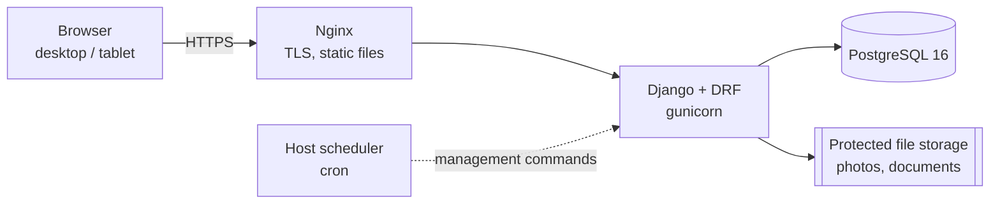

# Infrastructure — Docker Compose, Nginx, backups

> Status: placeholder. Created in Sprint 0 (`EN-005`) and hardened in Sprint 5.

**Lead:** Data, analytics and DevOps (spec §14).

One deployment = one customer (one plant or one hosted instance): its own database, its own
protected file storage, its own backups (spec §7.5).



## Planned structure

```text
infra/
├── docker-compose.yml          production-like stack: nginx, backend, frontend build, postgres
├── docker-compose.dev.yml      development overrides (hot reload, exposed ports)
├── nginx/
│   └── crucible.conf           TLS ≥ 1.2, security headers, protected media path
├── backup/
│   ├── backup.sh               database + uploaded files, encrypted, to separate storage
│   └── restore.sh              documented, tested restore (NF3: RPO 24 h, RTO 4 h)
└── docs/
    └── on-premise-install.md   installation guide for a plant server
```

## Environments

| Environment | Purpose |
|-------------|---------|
| development | each developer's machine |
| staging | demonstrations, integration testing, pilot validation — mirrors production |
| production | one per customer, Algerian data centre or plant network |
